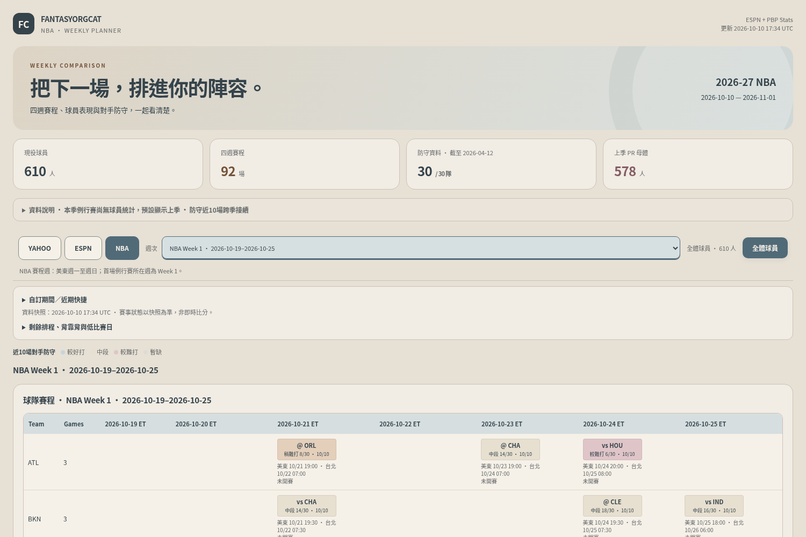
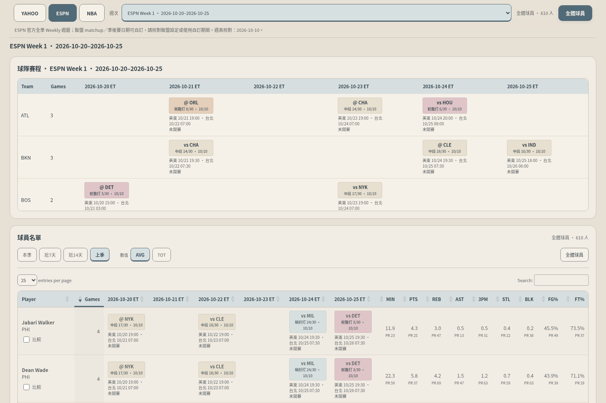
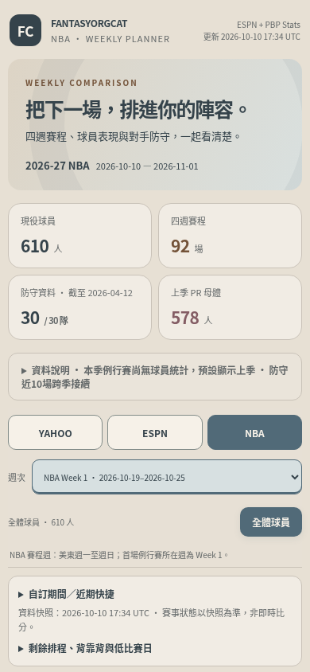

# Morandi palette review

Base: `e297ca272591b4689e421ba8902caf14ac68bab9` in `fantasyorgcat/fantasyorgcat.github.io` (repository ID 1101177706). The verified Daily run [38072033267](https://github.com/fantasyorgcat/fantasyorgcat.github.io/actions/runs/38072033267) succeeded on 2026-10-10 at 17:34:51 UTC. Its real report has 610 roster players and NBA25/Yahoo23/ESPN24 available periods. The October 11 08:17 UTC scheduled run had not yet been due during this review; no schedule success is assumed.

## Palette and persistent sources

| Role | Colour | Use |
|---|---|---|
| Warm beige | `#E7E0D4` | Page and sticky toolbar |
| Soft ivory | `#F6F1E8` | Tables, controls, scroll surfaces |
| Warm panel | `#F1ECE4` | Cards, comparison and alternate rows |
| Deep gray blue | `#35434B` | Body, numbers and identity |
| Warm gray | `#626768` | Supporting labels and PR |
| Muted blue | `#516A78` | Primary buttons, active platform, sorting |
| Blue gray tint | `#D7E0E1` | Selected controls and teams |
| Soft orange | `#E4CFBB` | Mildly difficult matchup band |
| Dusty rose | `#DFC5C8` | Difficult matchup band |
| Muted blue tint | `#C5D5DC` | Easier matchup band |

`dashboard.css` changes surfaces, hero, controls, headers, rows, comparison, hover, focus, disabled and sorting states. Its existing dimensions and scroll behaviour are retained. `generate_report.py` uses the shared muted text colour for team/PR labels and derives legend colours from `utils.get_color_for_rank`. The existing five rank bands keep the same thresholds; `utils.py` changes only their colours. Badges now state 較難打／稍難打／中段／稍好打／較好打 alongside the original rank/population and game sample. Missing defense remains neutral and explicitly says 防守暫缺. Comparison sorting gets an arrow using its existing accessible sort label; no ranking or JavaScript data logic changes.

These sources are read by every report generation. The draft does not replace the tracked production `index.html` or `data_snapshot.json`. A separately saved interactive review restyles the exact real published report without fetching new data or changing its data timestamp. The next report generation from the reviewed source will embed the palette; publishing requires separate approval.

## Real preview and data preservation

The real review retains `2026-10-10 17:34 UTC`. The snapshot is byte-identical to main, SHA256 `6cde860d32e31b257ab739c2b06072903e59bf237d28a59d2e4ce01a1ace1894`.

A normalization comparison removes only the CSS block, the specified heat/label colours and the added difficulty wording. The complete before/after report is then identical, covering inline scripts, player statistics, PR/Rank, events, periods, timestamps and other markup. The final restyled preview index SHA256 is `774eee7bff0b3acf3f7b4a4a126f141d3ba3d6659ef701f7a5b9c5d24d58e007`. It is a restyled published snapshot, not newly fetched October 11 data.

The isolated generated fixture is clearly marked UI TEST ONLY and is rejected by the publication gate. Final generation separately confirms the embedded stylesheet equals the final `dashboard.css` exactly. No fixture is substituted for the real screenshots or snapshot.

## Validation

- 45 repository unit tests pass; JavaScript syntax checks pass.
- The production and real-preview security gates pass. The synthetic fixture is correctly refused.
- `test_dashboard_browser.py` passes against the 610-player real preview: independent filters, search, period/mode preservation, numeric percentage sorting, total counts, details, mobile horizontal scroll and sticky controls.
- `test_schedule_browser.py` passes at 1500/390px against its isolated fixture: ESPN24, three-platform round trips, Cup/All-Star handling, custom windows, remaining timer/foreground refresh and blank selection preservation.
- `test_season_browser.py` passes every NBA25/Yahoo23/ESPN24 period, with exact statistics/PR invariance and schedule/date/opponent checks.
- `test_player_tools_browser.py` passes all 72 periods at both widths, comparison, ranks, sorting, independent controls and storage preservation.
- Additional real before/after checks at 1500/390px preserve 610 players and all platform counts, compare Victor Wembanyama and Nickeil Alexander-Walker through all platforms, and exercise AVG/TOT, Rank sorting, hover, 3px keyboard focus and dashed disabled state. No page-wide mobile overflow, external requests, JS errors or failed resources.

Sampled normal text contrast is 4.78–7.79; input boundary contrast 3.12 and focus contrast 4.27. The values cover the main surfaces, selected platform/stat controls, header, PR and the darkest heat background. They are scoped palette measurements, not a complete accessibility certification. The disabled appearance was temporarily exercised in the isolated browser; all three verified production-season platforms remain enabled.

These are cloud-executor checks, not GitHub CI or new live-site acceptance. Repository requirements were installed into an isolated temporary venv; Playwright/Chromium were already present. No new credential, payment, workflow edit, dispatch, merge or public deployment was made.

```sh
python -m unittest test_sources test_defense test_schedule test_player_catalog
node --check schedule_tools.js
node --check player_tools.js
python security_gate.py
CHROMIUM_PATH=/usr/bin/chromium python test_schedule_browser.py <isolated-fixture-directory>
CHROMIUM_PATH=/usr/bin/chromium python test_dashboard_browser.py <real-review-url>
CHROMIUM_PATH=/usr/bin/chromium python test_season_browser.py <fixture-url>
CHROMIUM_PATH=/usr/bin/chromium python test_player_tools_browser.py <fixture-url>
```

## Before and after

Desktop home: [before](docs/morandi/before-home-1500.png) / [after](docs/morandi/after-home-1500.png).



Desktop schedule: [before](docs/morandi/before-schedule-1500.png) / [after](docs/morandi/after-schedule-1500.png).



390px home: [before](docs/morandi/before-home-390.png) / [after](docs/morandi/after-home-390.png).



390px schedule: [before](docs/morandi/before-schedule-390.png) / [after](docs/morandi/after-schedule-390.png).

The cloud review bundle also contains before/after comparison and focus screenshots, the interactive real preview, fixture results, and preservation/contrast evidence. The review bundle is local/downloadable; no public preview site has been deployed.
